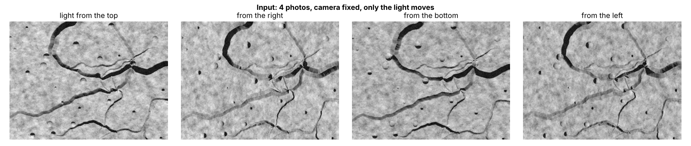
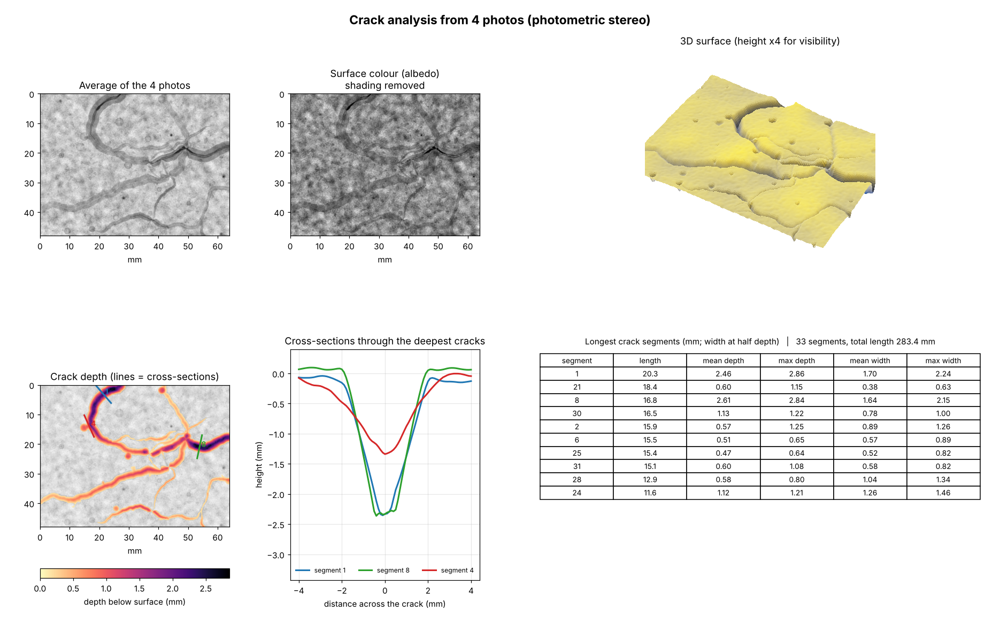
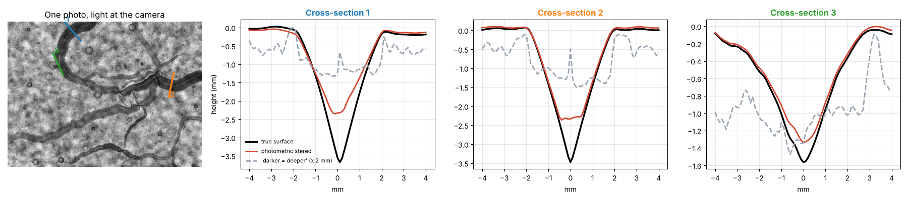
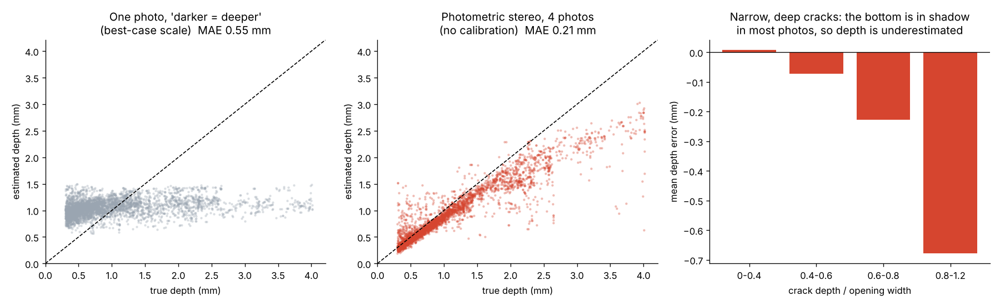
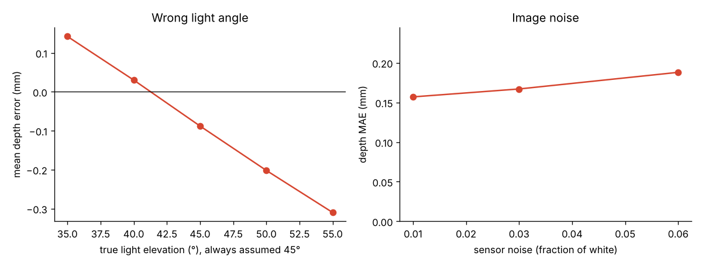
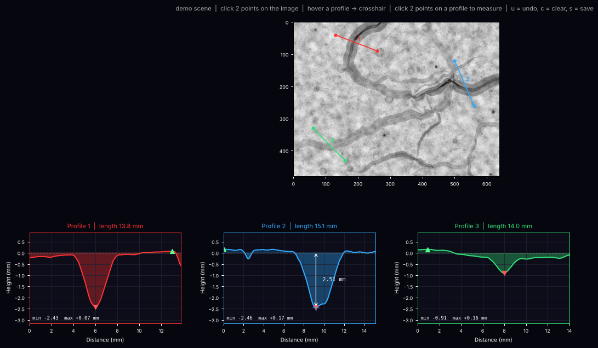

# Crack Depth Explorer

**Measure cracks in 3D (depth, width and length in millimetres) from four ordinary photos.**
Keep the camera still, take one photo with the light coming from each of four sides, and the tool
reconstructs the surface with **photometric stereo**. Then it finds every crack and measures it.





**Skills shown:** physics-based computer vision (photometric stereo, Lambertian reflectance) ·
least-squares normal estimation with shadow handling · gradient-field integration (Poisson / DCT) ·
morphological measurement on height maps · a renderer with known ground truth for validation ·
robustness analysis · interactive matplotlib tool · NumPy / SciPy / OpenCV / scikit-image

---

## Why not just use one photo?

In a single photo, a crack is darker than the surface around it. It is tempting to assume
"darker = deeper", but brightness also depends on the **colour of the material**, on dirt, on
shadows and on how wide the crack is. The image has no height information.

Photometric stereo removes this ambiguity. A matte surface point looks brightest when it faces the
light. With three or more photos lit from known directions, both the **surface orientation** (normal)
and the **surface colour** (albedo) of every pixel can be solved separately. Integrating the normals
gives the height map in real units.

The comparison below uses a rendered scene, so the true surface is known. Photometric stereo follows the
true cross-section. The single-photo shortcut does not, even after giving it its best possible scale factor:



## How it works

| Step | Method |
|---|---|
| 1. Linearise | phone JPEGs are sRGB-encoded; convert them back to linear brightness |
| 2. Normals + albedo | per pixel, least squares for `I = L · (albedo · n)`. With 4 lights, the darkest observation is dropped when it looks like a **cast shadow**, and the other 3 still determine the normal |
| 3. Height map | the normals give the surface slopes; the **Poisson equation** is solved with a discrete cosine transform (least-squares integration), then a tilted plane is removed |
| 4. Crack depth | **closing − height**: a morphological closing bridges every valley narrower than the structuring element, so the difference is the depth **below the local surface** (the black-hat transform, applied to heights instead of grey values) |
| 5. Crack mask | hysteresis threshold on the depth (≥ 0.4 mm somewhere, continues while ≥ 0.15 mm). A shape filter removes round air voids |
| 6. Measurements | skeleton → split at junctions into segments → length, depth and width per segment. Width is measured **at half depth**, because the chipped top edge of a real crack is not well defined |

## Validation

[`render.py`](render.py) creates cracked concrete surfaces with a known 3D shape and renders them under four lights. The renders include:

- **Surface:** surface roughness, air voids, mottled colour, darker grains and dirtier crack walls.
- **Cracks:** branching cracks whose width and depth vary along their length.
- **Imaging effects:** cast shadows, sensor noise and sRGB gamma.

[`validate.py`](validate.py) runs the whole pipeline on **20 unseen scenes** and compares the results at **41,299 crack centre-line points** (true depth 0.3–4.0 mm):

| | Photometric stereo (4 photos, no calibration) | One photo, "darker = deeper" (best-case scale) |
|---|---|---|
| Depth: mean abs. error | **0.21 mm** | 0.55 mm |
| Depth: median abs. error | **0.10 mm** (13 %) | 0.46 mm |
| Depth: correlation with truth | **0.93** | 0.31 |
| Width (at half depth): median abs. error | **0.14 mm** | not measurable |
| Crack detection: precision / recall | **0.96 / 0.97** | n/a |

The single-photo method is given the scale factor that fits the true depths best. That is help it would never get in practice, and it is still far off. Photometric stereo gets no information from the truth.



**Where it fails (right panel):** in a crack that is deep compared with its width, the bottom is in shadow in most of the photos. The floor cannot be seen, so it cannot be measured.

| Depth / width ratio | Median abs. error | Mean error (bias) |
|---|---|---|
| below 0.4 | 0.05 mm | 0.01 mm |
| 0.4 – 0.6 | 0.08 mm | −0.07 mm |
| 0.6 – 0.8 | 0.17 mm | −0.23 mm |
| 0.8 – 1.2 | 0.62 mm | −0.68 mm |

**For narrow, deep cracks, the measured depth is a lower bound.** A depth gauge or a core is still needed for those cracks.

**Robustness** (8 more scenes): see [`results/validation.json`](results/validation.json).

- **Light angle:** if the elevation is wrong by ±5°, the depth shifts by about 0.1 mm. At ±10° the error is 0.2–0.3 mm. If the real light is lower than assumed, cracks come out deeper, and vice versa.
- **Noise:** 6 times more sensor noise raises the mean error only from 0.16 to 0.19 mm.
- **Three lights instead of four:** still works (mean error 0.19 mm vs 0.16 mm), but there is no spare light to fall back on when one is shadowed.



## Usage

```bash
pip install -r requirements.txt

python render.py                        # demo scene -> demo/scene_N/E/S/W.png + truth.npz
python analyze.py demo/scene_N.png demo/scene_E.png demo/scene_S.png demo/scene_W.png --px-mm 0.1
python profile_tool.py demo/scene_N.png demo/scene_E.png demo/scene_S.png demo/scene_W.png --px-mm 0.1
python validate.py                      # about 10 min
python make_figures.py                  # figures of this README
```

`analyze.py` writes `report.png`, `crack_segments.csv` (one row per crack segment), `height_mm.npy` and `summary.json`.

### Your own photos (phone + torch)

1. Put the phone on a tripod or a stack of books, **looking straight down**. Lock focus and exposure (in most camera apps, long-press on the screen).
2. Place a **ruler** in the picture to get the pixel size (`--px-mm`).
3. Darken the room. Hold the torch at the **same distance** each time, as far away as practical (at least 5× the width of the photographed area), at about **45° above the surface**. Take one photo with the light from the top of the image, then from the right, the bottom and the left. Tape marks on the floor help.
4. Run:

```bash
python analyze.py top.jpg right.jpg bottom.jpg left.jpg --azimuth 90 0 270 180 \
       --elevation 45 --px-mm 0.08 --scale 0.25 --detrend-mm 30 --out results/wall
```

`--azimuth` is the direction the light comes from (0 = right, 90 = top of the image). `--detrend-mm` removes the broad bending that an uneven, close torch adds to the surface; cracks are narrow and are not affected.

### Interactive profile tool

Click two points on the image to get the height profile along that line. Click two points on a profile to measure a depth or a width. Keys: `u` undo, `c` clear, `s` save PNG + CSV. In Jupyter, use `%matplotlib widget` (needs `ipympl`).



## Project structure

```
crack-depth-explorer/
├── photostereo.py     # light directions, normals + albedo, integration, detrending
├── cracks.py          # local depth, crack mask, skeleton segments, depth/width/length
├── analyze.py         # command line: photos -> report, CSV, height map
├── report.py          # one-page report figure
├── profile_tool.py    # interactive cross-sections (script or Jupyter)
├── render.py          # synthetic cracked surfaces with known 3D shape, rendered under N lights
├── validate.py        # accuracy and robustness against the known truth
├── make_figures.py    # figures of this README
├── demo.ipynb         # walk-through with outputs
├── demo/              # rendered demo scene (4 photos + truth)
├── images/            # README figures
└── results/validation.json
```

## Limitations

- **Matte surfaces only.** Wet, glossy or shiny surfaces break the Lambertian model. Concrete, plaster, stone and asphalt are usually matte enough.
- **Deep, narrow cracks:** their floor stays in shadow, so the depth is a lower bound (see above).
- **Light directions must be known.** An error of 5° in elevation gives about 0.1 mm depth error. Measuring the angle once with a protractor or a phone level app is enough.
- **Validated on rendered scenes.** The renderer models the main effects (shadows, albedo, noise, gamma) but not interreflections inside cracks or a torch that is close to the surface. Measuring a few real cracks with a depth gauge would be the next step.

## License

[MIT](LICENSE)
